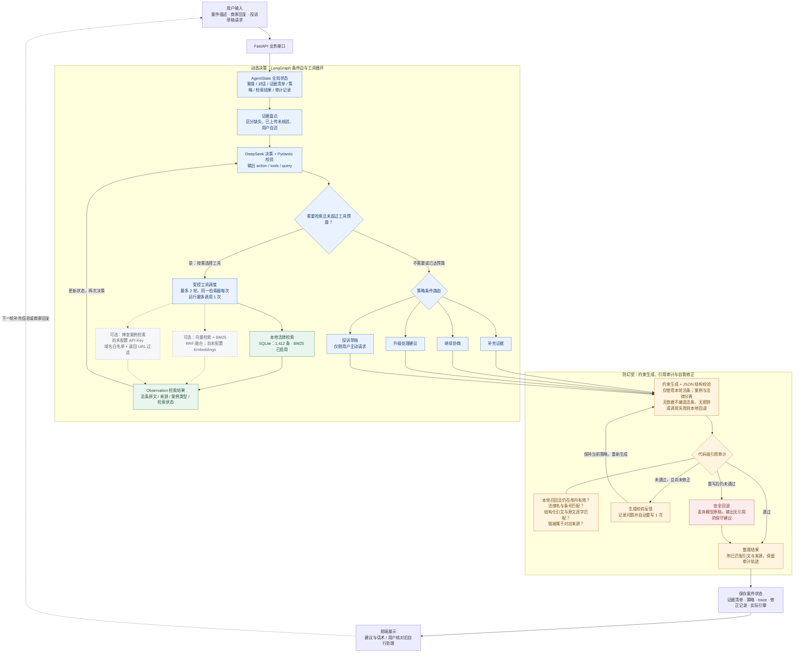

# 当前 Agent 架构：动态决策与防幻觉

依据 2026-11-15 工作区代码与本地配置绘制。实线表示当前可用流程；灰色虚线节点表示已实现接口、尚未配置的可选能力。

## 动态决策

- 决策依据包含案情、最近对话、上一轮策略、证据状态及本轮工具观测；模型选择动作和检索工具，由代码约束合法值。
- 核心交易或付款证据不足时优先补证；投诉文书只在用户主动请求投诉草稿时生成。
- 检索后进入 decide 节点再次判断。工具轮次最多两轮，每个检索器同次工作流只调用一次；引用自修正最多一次。
- 案件层持久化部分状态和 trace，并在后续请求中重建 AgentState；当前未使用 LangGraph checkpointer，不等于图内断点续跑。

## 防幻觉边界

- 本地法条与联网案例用途分离，黑猫投诉属于投诉人陈述，不能当成法院认定或法律依据。
- 提示词要求仅依据召回原文作答；Pydantic 约束 JSON 结构，引用审计核对本次召回条文、条号、来源和结构化引文。
- 修正仍失败时丢弃模型稿，保留错误历史并输出不含法条引用的固定建议。
- 来源匹配不等于法律适用正确。正则与逐字校验不能验证所有释义和事实；不应宣称“彻底消除幻觉”或“准确率 100%”。
- 法律原文来自本地下载文件，来源和版本日期由用户提供；尚未对官方全文逐条比对。
- 证据仅有上传元信息和用户自述，尚无 OCR、正文理解或真实性核验。

## 当前配置

- 本地法律库：1,412 条，BM25 可用。
- 向量与 BM25 的 RRF 混合检索：代码已实现，未配置 Embeddings。
- 博查白名单案例检索：代码已实现，未配置 BOCHA_API_KEY。
- 模型错误或 JSON 校验失败：使用本地回退，并记录实际 engine。

## 对应代码

- backend/app/agents/workflow.py：状态与条件边、工具循环、引用修正和安全回退。
- backend/app/services/agent.py：决策/生成提示词、JSON 校验、动作约束及模型失败回退。
- backend/app/services/retrieval.py：BM25、向量融合、案例白名单和引用核对。
- backend/app/services/evidence.py：证据状态盘点。
- backend/app/main.py：接口与案件状态持久化。
